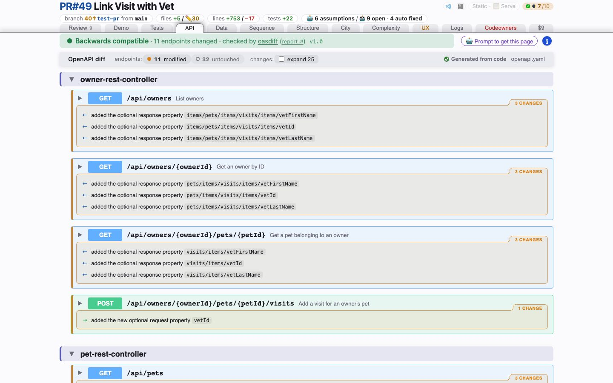

# API
<!-- panel: api -->

> Every REST operation and schema the branch moved, each classified breaking / additive / changed / cosmetic — and a verdict from an independent differ on top.

<!-- shot:begin -->
<!-- generated by `skills/human-review/scripts/readme-tour.py` on every publish of the featured snapshot — edits between these markers are overwritten -->

[Open this tab in the live demo](https://victorrentea.github.io/human-review/demo/review.html#api) · [all tabs](../../README.md#a-tour-one-tab-at-a-time)
<!-- shot:end -->

## What you see

- **The verdict band** — *backwards compatible* or *breaking*, and how many endpoints, from
  [`oasdiff`](https://github.com/oasdiff/oasdiff) alone, with its full report one click away.
  The skill used to run its own differ beside it; [an eval on 121 spec
  pairs](../../skills/human-review/reference/openapi-differ-eval.md) showed it wrong far more
  often than oasdiff, so it was dropped and the clear cases only it caught were reported upstream.
- **The OpenAPI visual diff** — every operation the branch touched, expanded, with each change
  labelled; the untouched ones folded away.
- **The effective payload** — `$ref`s resolved, so a property that moved in a shared schema
  shows up at every operation that serves it, not once in a place nobody looks.
- **Tree | Diagram** — under Schema, the same payload as a PlantUML class diagram: one class per
  object schema, an association for each nested or referenced object, array items too. The
  delta is the Data tab's own (`puml_diff.py`): a new field or class green, a removed one red
  and struck, amber around what changed, and plain when nothing did. The choice holds for
  every open operation. Drawn at build time, each distinct picture carried once.
- **One row per body** — Schema, Example Value and the media type share a line; a media type
  or an example that has no alternative is plain text, not a dropdown.

It reads the contract, not the handler: a `PUT` that starts *clearing* a field looks
additive to any structural differ.

## What it needs

- An OpenAPI spec the project generates (`human-review.json` names it), **PyYAML**, and a JVM
  or Docker. `oasdiff` resolves what the fallback cannot.
- **PlantUML** (and its Graphviz) for the diagrams, as on the Data tab. Without it the switch
  is not offered and the tree is what you get.

## Deeper

- [The OpenAPI contract differ](../../README.md#the-openapi-contract-differ)
- Produced by [`openapi-compat.py`](../../skills/human-review/scripts/openapi-compat.py),
  [`openapi-visual-diff.py`](../../skills/human-review/scripts/openapi-visual-diff.py) and
  [`schema_puml.py`](../../skills/human-review/scripts/schema_puml.py)
