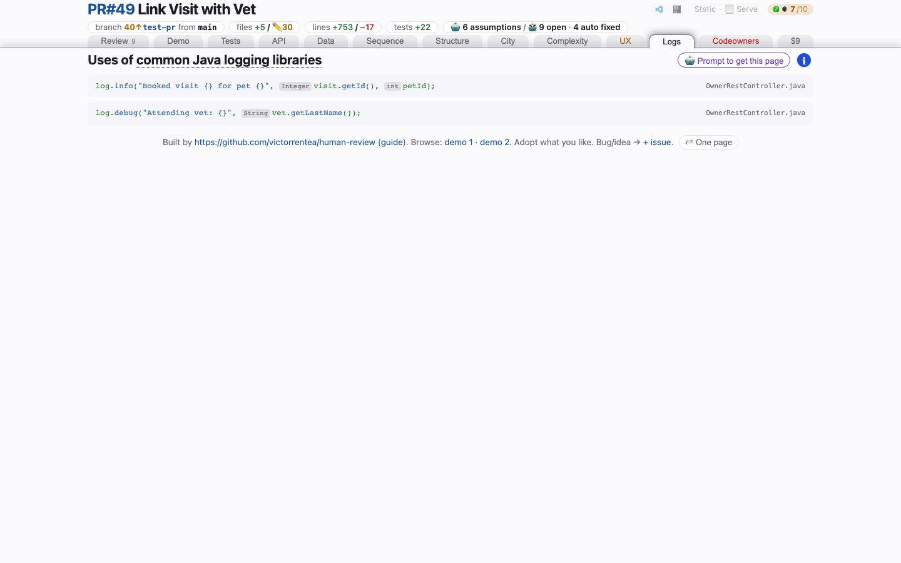

# Logging
<!-- panel: logging -->

> What the change set will say for itself in production — every logging statement it adds or changes, found by syntax, not by grep, and whether a value it logs is personal data.

<!-- shot:begin -->
<!-- generated by `skills/human-review/scripts/readme-tour.py` on every publish of the featured snapshot — edits between these markers are overwritten -->

[Open this tab in the live demo](https://victorrentea.github.io/human-review/demo/review.html#logging) · [all tabs](../../README.md#a-tour-one-tab-at-a-time)
<!-- shot:end -->

## What you see

- **Every new or changed log line**, cut from the working tree, each a click into your editor
  or onto GitHub. A rewritten line says what it was, and whether it still logs the same text.
- **⚠ chips** where Ludvig's logging standard asks to look twice, each saying why on hover:
  a value named like personal data (`email`, `personnummer`…), an organisation number (it can
  be a personal number), a payload or event logged whole, an f-string message instead of
  values in `extra=`.
- A chip is a question for the reviewer, read off names in the code — never a verdict.

## What it needs

- Nothing to install: [`logextract.py`](../../skills/human-review/scripts/logextract.py)
  parses Python with the standard library's `ast`. It recognises `aws_lambda_powertools`'
  `Logger`, `logging`, `structlog` and `loguru`, and a logger imported from another module
  of the service.
- It scans `src`, `lambdas`, `backend` and `src_py` when they exist (tests are left out);
  `steps.logging.paths` in `human-review.json` overrides that.

## Deeper

- Produced by [`logextract.py`](../../skills/human-review/scripts/logextract.py), rendered by
  [`hrbuild/tabs/logging.py`](../../skills/human-review/scripts/hrbuild/tabs/logging.py)
