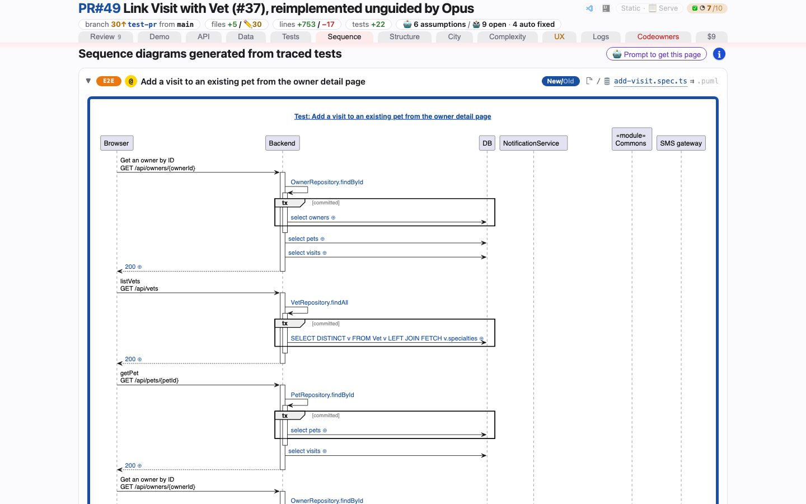

# Sequence
<!-- panel: sequence -->

> Sequence diagrams recorded from real traces of real test runs, each beside the test that produced it — and the tests tagged for tracing that came back without one.

<!-- shot:begin -->
<!-- generated by `skills/human-review/scripts/readme-tour.py` on every publish of the featured snapshot — edits between these markers are overwritten -->
<a href="https://victorrentea.github.io/human-review/demo/review.html#sequence"></a>

[Open this tab in the live demo](https://victorrentea.github.io/human-review/demo/review.html#sequence) · [all tabs](../../README.md#a-tour-one-tab-at-a-time)
<!-- shot:end -->

## What you see

- **How were these produced?** — shut, at the top: three lines on what a span and a
  trace are, and under them a screenshot of a trace in Grafana Tempo: one of a test on the
  tab, linked to that test's diagram so the two can be compared, when the run had a Grafana
  to shoot it in — otherwise an example kept with the skill.
- **One fold per test** — tagged API · JUnit, UI · Playwright or UI · Gherkin. Open one and
  the diagram that test's run actually produced is beside its source.
- **Why each picture is there** — `tagged` (the test carries `@generate_sequence` /
  `@GenerateSequence`) or `new test` / `edited test` (the branch wrote it, and the step traced
  it untagged). A line under the title names the branch's tests that were traced, the ones
  that came back without a picture, and the ones left out — over the cap, or in a file no
  traced suite runs.
- **Diff / New/Old** — what the branch changed in that flow: new calls green, calls that
  disappeared red and struck.
- Nothing is drawn by hand: a call is on the diagram because it *happened* during the test.

## What it needs

- Tests tagged for tracing, and the project's traced test run named in `human-review.json`.
- Somewhere for the traces to land. Best: `steps.sequence.app`, the block `video.app` is,
  whose `up` builds the commit under review **with its own trace store** and whose `vars`
  command prints every host-picked address as `NAME=value` lines; they are exported to the
  commands, and `down` runs in a `finally`. Several branches can then be traced at once, each
  into its own Tempo, from a freshly seeded database. `requires` (URLs or `tcp://host:port`,
  `{NAME}` expanded from `vars`) is probed before any command runs — after `up` with an
  `app`, before anything without one — and a miss is a skip naming what did not answer:

  ```json
  "sequence": {
    "app": {
      "up": "./start-docker.sh up --ref {sha} --name petclinic-{shortsha}-otel --otel --fresh",
      "vars": "./start-docker.sh ports petclinic-{shortsha}-otel",
      "down": "./start-docker.sh down petclinic-{shortsha}-otel"
    },
    "requires": [{"url": "{GRAFANA_URL}/api/health", "what": "Grafana"},
                 {"url": "{OTEL_EXPORTER_OTLP_ENDPOINT}/v1/traces", "what": "OTLP collector"}],
    "commands": ["cd petclinic-test && ./run-tests-with-tracing.sh"]
  }
  ```

- The branch's own tests, untagged: `select` reads the test manifest, keeps the tests a
  traced suite runs and that carry no tag, ranks them (the file with the most new tests
  first, added before edited), lets the suites take turns up to `max` (default 6), and
  expands `{tests.<suite>}` in the commands to the picks — each spelled by `item` (`{name}`
  `{file}` `{path}` `{line}` `{class}`), joined by `join`, as one shell word. A command
  written `{"run": …, "when": "<suite>"}` runs only when that suite picked something:

  ```json
  "select": {"max": 6, "suites": {
    "e2e":  {"files": ["petclinic-test/src/**/*.feature"], "item": "{file}::{name}",
             "join": "\n", "max": 4},
    "java": {"files": ["petclinic-backend/src/test/java/**/*.java"],
             "item": "{class}#{name}", "join": ",", "max": 2}}},
  "commands": [
    "cd petclinic-test && GENSEQ_SELECT={tests.e2e} ./run-tests-with-tracing.sh",
    {"run": "cd petclinic-backend && GENSEQ_SELECT={tests.java} mvn -Pgenseq test -Dtest={tests.java}",
     "when": "java"}]
  ```

  The project's runners decide how a named test is traced; petclinic's read `GENSEQ_SELECT`
  beside the tag. What was picked and left is in `assets/sequence.selection.json`.
- For the trace screenshot, a Grafana with the run's traces while the stack is up — the
  `app`'s own `GRAFANA_URL` by default, or `"trace": {"grafana": …, "attribute":
  "span.test.name"}` — and a span attribute carrying each test's name. Without them the
  tab shows the skill's own example trace instead, so a bare Tempo (no Docker, no Grafana)
  is enough for the whole tab; `"trace": false` turns the shot off.

## Deeper

- [The PlantUML differs](../../README.md#the-plantuml-differs) — the sequence differ keeps
  order, because the same arrow twice is two events
- Built by [`hrbuild/tabs/sequence.py`](../../skills/human-review/scripts/hrbuild/tabs/sequence.py)
