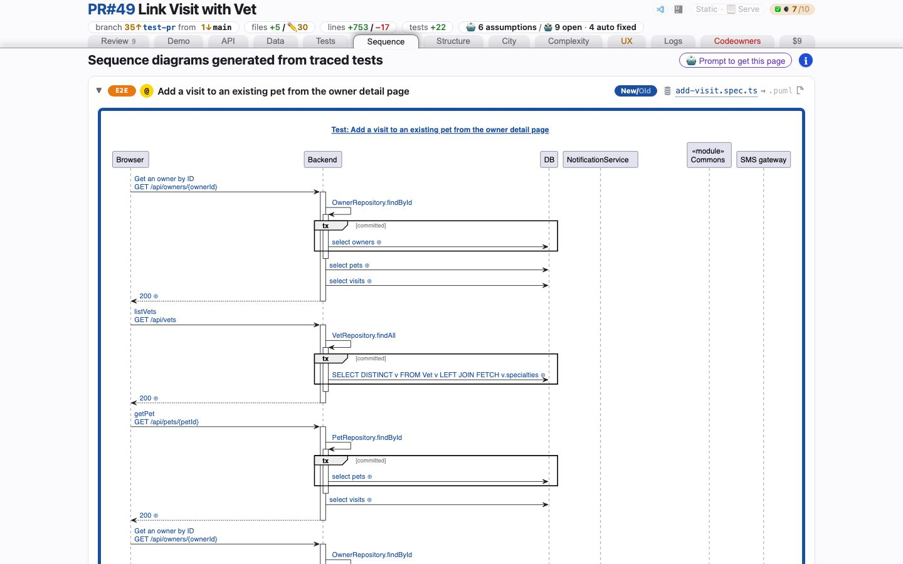

# Sequence
<!-- panel: sequence -->

> Sequence diagrams recorded from real traces of real test runs, each beside the test that produced it — and the tests tagged for tracing that came back without one.

<!-- shot:begin -->
<!-- generated by `skills/human-review/scripts/readme-tour.py` on every publish of the featured snapshot — edits between these markers are overwritten -->
<a href="https://victorrentea.github.io/human-review/demo/review.html#sequence"></a>

[Open this tab in the live demo](https://victorrentea.github.io/human-review/demo/review.html#sequence) · [all tabs](../../README.md#a-tour-one-tab-at-a-time)
<!-- shot:end -->

## What you see

- **How were these produced?** — shut, at the top: three lines on what a span and a
  trace are, and under them a screenshot of a trace in Grafana Tempo: one of a test on the
  tab, linked to that test's diagram so the two can be compared, when the run had a Grafana
  to shoot it in — otherwise an example kept with the skill.
- **One fold per test** — tagged API · JUnit, UI · Playwright or UI · Gherkin. Open one and
  the diagram that test's run actually produced is beside its source.
- **Why each picture is there** — `tagged` (the test carries `@generate_sequence` /
  `@GenerateSequence`) or `new test` / `edited test` (the branch wrote it, and the step traced
  it untagged). A line under the title names the branch's tests that were traced, the ones
  that came back without a picture, and the ones left out — over the cap, or in a file no
  traced suite runs.
- **Diff / New/Old** — what the branch changed in that flow: new calls green, calls that
  disappeared red and struck.
- Nothing is drawn by hand: a call is on the diagram because it *happened* during the test.

## What it needs

**A Python service (Ludvig)** — nothing but its own pytest. The skill ships a pytest plugin,
[`hr_genseq`](../../skills/human-review/scripts/genseq/hr_genseq.py), which the Sequence step
puts on `PYTHONPATH`. While a traced test runs it records every call from one class (or
module) of the service into another, and every call out of it — each boto3 operation, each
SQL statement, each `requests` call — and writes the test's diagram, named after the test.
It traces the tests marked `@pytest.mark.genseq`, and the ones `HR_GENSEQ_SELECT` names:

```json
"sequence": {
  "select": {"max": 6, "suites": {"pytest": {
    "files": ["tests/**/test_*.py"], "exclude": ["tests/simulation/**", "tests/e2e/**"],
    "item": "{path}::{name}", "join": "\n"}}},
  "commands": [{"run": "HR_GENSEQ_SELECT={tests.pytest} pipenv run python -m pytest -p hr_genseq -q",
                "when": "pytest"}]
}
```

`select` picks the tests this branch wrote or edited (the file with most new tests first, up
to `max`) and `{tests.pytest}` hands them to the run; every other test is deselected, so the
run costs what the traced tests cost. The drawings go to `.human-review/`, never into the
repository. `HR_GENSEQ_ROOTS` (default `src,lambdas,backend,src_py`) says which folders are
the service; `HR_GENSEQ_MAX` caps the arrows (120).

**Upstream's OpenTelemetry route** (a JVM app traced into Tempo, `steps.sequence.app`,
`requires`, a Grafana shot) still works for a project that has one; see upstream's docs.

## Deeper

- [The PlantUML differs](../../README.md#the-plantuml-differs) — the sequence differ keeps
  order, because the same arrow twice is two events
- Built by [`hrbuild/tabs/sequence.py`](../../skills/human-review/scripts/hrbuild/tabs/sequence.py)
