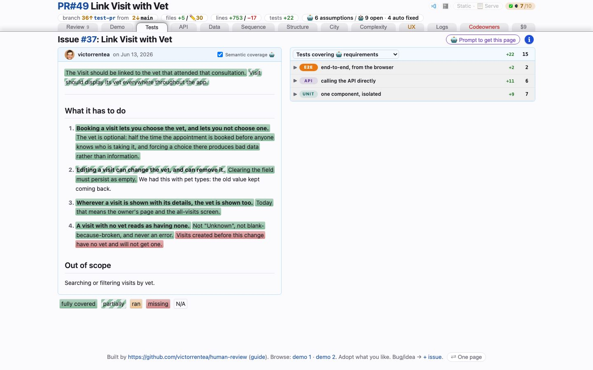

# Tests
<!-- panel: requirements -->

> What the change set was supposed to do, the tests that pin each sentence of it, and what the branch did to the test run — including the tests it stopped running without deleting.

<!-- shot:begin -->
<!-- generated by `skills/human-review/scripts/readme-tour.py` on every publish of the featured snapshot — edits between these markers are overwritten -->
<a href="https://victorrentea.github.io/human-review/demo/review.html#requirements"></a>

[Open this tab in the live demo](https://victorrentea.github.io/human-review/demo/review.html#requirements) · [all tabs](../../README.md#a-tour-one-tab-at-a-time)
<!-- shot:end -->

## What you see

- **The ticket, highlighted** — every sentence of it coloured by how well it is pinned:
  fully covered, partially, only executed, or missing.
- **Covering tests** — the tests matched to each sentence, tagged UI / API / UNIT, each
  marked new (+) or edited (✎), each a click to its source line.
- **The test ledger** — how many tests entered the run and how many left it. A test can be
  deleted, commented out or `@Disabled`; all three cost the run the same test, and only the
  first shows up in a diff.
- **Recordings** — each Playwright test opens on Playwright's own trace viewer, inside the
  tab: every action with the page either side of it, the DOM, the console and the network.

## What it needs

- **The ticket** the matrix pairs with tests: a GitHub issue (`#N` in the PR title or
  branch), or — Ludvig — a **Jira issue** whose key (`ML-3944`, `POG-12`) is in
  `review-points.md`'s `ticket:`, the PR title or the branch name. Jira is read with your own
  API token, from `JIRA_BASE_URL`, `JIRA_EMAIL` and `JIRA_API_TOKEN` in the environment or in
  `~/.config/human-review/jira.env`, once, and cached in `ticket-body.json`.

- Your project's test commands in `human-review.json`; Playwright with `--trace on` for the
  recordings. The matching of tests to sentences is the one part a model writes.
- **Per-test coverage of a Python service** (`steps.testcov.pytest`): the service's own
  pytest, run once under coverage.py with per-test contexts, in the service's environment
  — it needs `coverage` there (pytest-cov brings it):

  ```json
  "testcov": {
    "sources": ["src/**", "lambdas/**"], "exclude": ["src/alembic/**"],
    "pytest": [{"label": "pytest", "python": "pipenv run python", "args": "-q -p no:cacheprovider"}]
  }
  ```

  A test that hands a handler an API Gateway event counts as **API**, one under
  `tests/e2e/` as **E2E**, the rest as **Unit**. A changed `def` line counts as run when
  its body runs; a line run only at import is charged to no test, and says so.
- **Per-test coverage of a Vite/React front end** (`steps.testcov.vitest`, mitt-ludvig):
  the project's own Vitest run, with a setup file of this skill's added through a wrapper
  config under `node_modules/.cache/hr/` (nothing tracked changes). It takes V8's coverage
  around every test and maps it to source lines through the inline source maps Vite
  writes — no coverage provider needs installing:

  ```json
  "testcov": {
    "sources": ["frontend/src/**"], "exclude": ["frontend/src/**/*.test.*"],
    "vitest": [{"label": "Vitest", "cwd": "frontend",
                "command": "VITE_STAGE=jest VITE_USE_MOCK_AUTH=true npx vitest run"}]
  }
  ```

  Tests run one at a time within a file (`CI=true`), so each test's lines are its own.

## Deeper

- [Rerun, in the header](../../README.md#rerun-in-the-header) — the free rerun and the paid one
  that rewrites this matrix
- Built by [`hrbuild/tabs/tests.py`](../../skills/human-review/scripts/hrbuild/tabs/tests.py),
  from [`test-changes.py`](../../skills/human-review/scripts/test-changes.py),
  [`testcov.py`](../../skills/human-review/scripts/testcov.py) and
  [`playwright-traces.py`](../../skills/human-review/scripts/playwright-traces.py)
